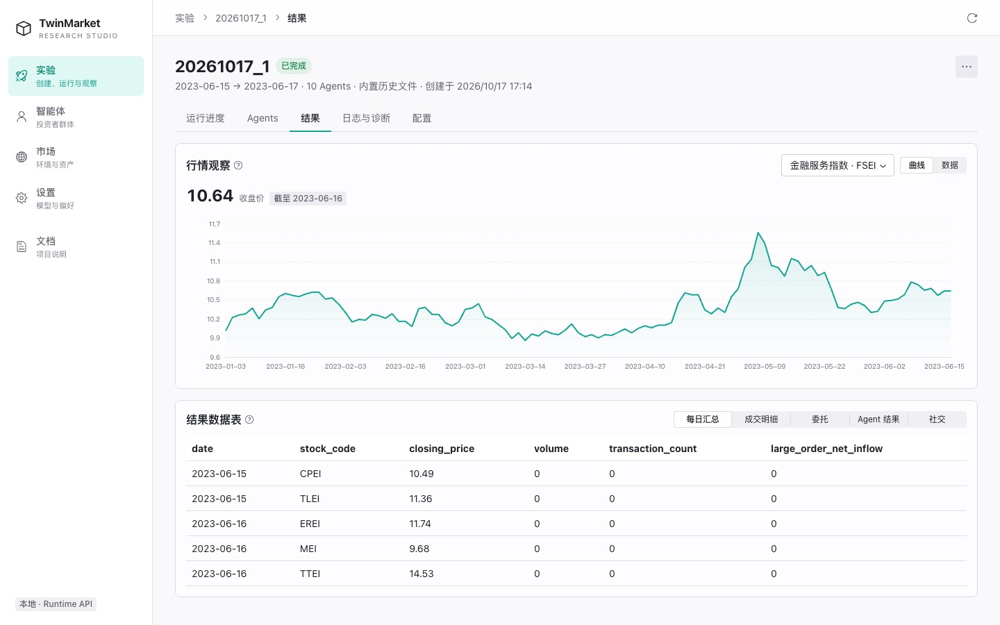

<div align="center">
  

  <p><strong>A Research Studio for TwinMarket market simulations</strong></p>

  [](README.md)
  [](README_zh.md)
  [](https://arxiv.org/abs/2502.01506)
  [](https://github.com/FreedomIntelligence/TwinMarket)
</div>

TwinMarketUI turns [TwinMarket](https://github.com/FreedomIntelligence/TwinMarket) into a local, browser-based workbench. TwinMarket is an LLM multi-agent stock market simulation (NeurIPS 2025). With TwinMarketUI you can set up an experiment, run it in the background, follow it one trading day at a time, and read the results, all without editing scripts.

<div align="center">
  
</div>

## What you can do

| Space | What it covers |
| --- | --- |
| **Experiment** | Pick a date range, the number of agents, concurrency and a market template, or copy an earlier experiment. You can run, stop, retry or resume from a checkpoint. A workspace shows progress, agents, results and logs for each run. |
| **Agent** | Browse investor agents built from real user profiles, including their style, behavioural biases and holdings. |
| **Market** | Manage trading rules and industry-index asset bundles, sync daily prices from Tushare, and publish immutable, reproducible market snapshots. |
| **Setting** | Configure and test the language model and the embedding model, and manage data-source credentials. |
| **Docs** | Read the project documentation from inside the app. |

Under the hood the simulation is the same as TwinMarket: agents trade on a forum-style social network, an order-driven market matches their orders, and the model reproduces stylized facts such as fat tails and volatility clustering.

## How it fits together

```text
Browser ──► frontend/  (React + Vite, :5173)
              │
              ├──► backend/server/          FastAPI control plane (:8766)
              │        run registry, read APIs, live run events
              │        └─► worker ─► python -m simulation  (one process per run)
              │
              └──► backend/market_service/  market data service (:8100)
                       data versions, templates, frozen market bundles
```

Each run gets its own folder under `backend/runs/<run_id>/`. The folder holds the frozen inputs, a `manifest.json`, the runtime event log and every result file, so a finished run can be inspected or resumed later.

## Quick start

**Requirements:** Python 3.10+, Node.js 18+, an OpenAI-compatible chat model API and an embedding model API.

```bash
cd backend

# 1. Python environment
python3 -m venv .venv
.venv/bin/python -m pip install -r server/requirements.txt

# 2. Model configuration (you can also edit these later on the Setting page)
cp config/api_example.yaml config/api.yaml
cp config/embedding_example.yaml config/embedding.yaml

# 3. Start the market data service, the backend and the frontend together
scripts/dev.sh
```

Open <http://127.0.0.1:5173/studio/> and create an experiment. On its first run, `dev.sh` installs the frontend dependencies, and pressing Ctrl-C stops all three processes. You can change the ports with `MDS_PORT`, `BACKEND_PORT` and `FRONTEND_PORT`.

The bundled 2023 data is enough to run experiments in the default `legacy` market mode. To sync recent prices into a market template, set a Tushare token, either with the `TUSHARE_TOKEN` environment variable or on the Setting page.

### Run from the command line

You can also run the simulation without the UI:

```bash
cd backend
USER_COUNT=10 START_DATE=2023-06-15 END_DATE=2023-06-16 bash scripts/run.sh
```

See [docs/SIMULATION_GUIDE_ZH.md](docs/SIMULATION_GUIDE_ZH.md) for every parameter, plus monitoring and resuming.

## Repository layout

```text
frontend/            Research Studio web app (React, Radix Themes, Vite)
backend/             All Python code; run Python commands from here
  server/            FastAPI control plane: run registry, worker, read APIs
  simulation/        Simulation core
    engine.py        Daily simulation loop (entry point: python -m simulation)
    agent.py         LLM client: provider adapters, context budget, retries
    trader/          Trading agents, prompts, matching engine
    stores/          User, forum and news databases
    runtime/         Runtime events, event store, snapshots
  market_service/    Market data service
  scripts/           dev.sh, run.sh, check.sh and other CLI tools
  config/            Model and data-source configuration
  data/              Simulation inputs (user template, prices, news index)
docs/                Documentation, also served on the in-app Docs page
```

## Development

```bash
cd backend
scripts/check.sh                 # compile + unit tests for simulation, market service and server
```

```bash
cd frontend
npm run build                    # production build
npm run test:sites               # Sites worker tests
```

Further reading:

- [Architecture and extension guide](docs/CODE_ARCHITECTURE_GUIDE_ZH.md)
- [Market data service design](docs/MARKET_DATA_SERVICE_DESIGN_ZH.md)
- [Runtime implementation notes](docs/P0_RUNTIME_IMPLEMENTATION_ZH.md)

## Acknowledgements and citation

TwinMarketUI builds on [TwinMarket](https://github.com/FreedomIntelligence/TwinMarket) by FreedomIntelligence. The simulation model, data and research findings come from the original paper. If you use them, please cite:

```bibtex
@inproceedings{yang2025twinmarket,
  title     = {TwinMarket: A Scalable Behavioral and Social Simulation for Financial Markets},
  author    = {Yuzhe Yang and Yifei Zhang and Minghao Wu and Kaidi Zhang and
               Yunmiao Zhang and Honghai Yu and Yan Hu and Benyou Wang},
  booktitle = {The Thirty-ninth Annual Conference on Neural Information Processing Systems (NeurIPS)},
  year      = {2025},
  url       = {https://arxiv.org/abs/2502.01506}
}
```

## License

MIT. See [LICENSE](LICENSE).
