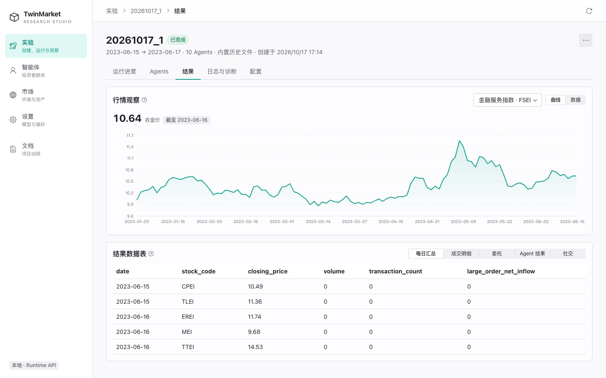

<div align="center">
  

  <p><strong>TwinMarket 市场模拟研究工作台</strong></p>

  [](README.md)
  [](README_zh.md)
  [](https://arxiv.org/abs/2502.01506)
  [](https://github.com/FreedomIntelligence/TwinMarket)
</div>

TwinMarketUI 把 [TwinMarket](https://github.com/FreedomIntelligence/TwinMarket) 变成一个在本地浏览器里使用的研究工作台。TwinMarket 是基于大语言模型的多智能体股票市场模拟（NeurIPS 2025）。有了 TwinMarketUI，不用改脚本，就能配置实验、在后台运行、按交易日跟踪进度，并查看结果。

<div align="center">
  
</div>

## 功能

| 空间 | 内容 |
| --- | --- |
| **实验** | 选择模拟区间、Agent 数量、并发数和市场模板，也可以复制已有实验。实验可以运行、停止、重试，或从断点续跑。每个实验有一个工作台，查看进度、Agent、结果和日志。 |
| **智能体** | 浏览基于真实用户画像构建的投资者群体，查看每个 Agent 的风格、行为偏差和持仓。 |
| **市场** | 管理交易机制和行业指数资产包，用 Tushare 同步收盘行情，发布可复现、不可变的市场快照。 |
| **设置** | 配置并测试语言模型和向量模型，管理数据源凭据。 |
| **文档** | 在应用内阅读项目文档。 |

模拟内核与 TwinMarket 相同：Agent 在论坛式社交网络中交流，在订单驱动的市场中交易，模拟结果能复现尖峰厚尾、波动聚集等典型事实。

## 架构

```text
浏览器 ──► frontend/  （React + Vite，:5173）
              │
              ├──► backend/server/          FastAPI 控制面（:8766）
              │        Run Registry、查询接口、实时运行事件
              │        └─► worker ─► python -m simulation（每个 Run 一个进程）
              │
              └──► backend/market_service/  市场数据服务（:8100）
                       数据版本、市场模板、冻结的市场资产包
```

每个 Run 在 `backend/runs/<run_id>/` 下有一个独立目录，里面有冻结的输入、`manifest.json`、运行事件日志和全部结果文件。运行结束后，可以随时回看，也可以续跑。

## 快速开始

**环境要求：** Python 3.10+、Node.js 18+、一个 OpenAI 兼容的对话模型 API 和一个向量模型 API。

```bash
cd backend

# 1. Python 环境
python3 -m venv .venv
.venv/bin/python -m pip install -r server/requirements.txt

# 2. 模型配置（之后也可以在“设置”页面修改）
cp config/api_example.yaml config/api.yaml
cp config/embedding_example.yaml config/embedding.yaml

# 3. 同时启动市场数据服务、后端和前端
scripts/dev.sh
```

打开 <http://127.0.0.1:5173/studio/> 创建实验。`dev.sh` 第一次运行时会自动安装前端依赖，按 Ctrl-C 会停止全部三个进程。端口可以用 `MDS_PORT`、`BACKEND_PORT`、`FRONTEND_PORT` 修改。

仓库自带的 2023 年数据足够在默认的 `legacy` 市场模式下运行实验。如果要把近期行情同步进市场模板，需要配置 Tushare Token：设置环境变量 `TUSHARE_TOKEN`，或者在“设置”页面填写。

### 命令行运行

也可以不用界面，直接运行模拟：

```bash
cd backend
USER_COUNT=10 START_DATE=2023-06-15 END_DATE=2023-06-16 bash scripts/run.sh
```

全部参数，以及监控和续跑方法，见 [docs/SIMULATION_GUIDE_ZH.md](docs/SIMULATION_GUIDE_ZH.md)。

## 目录结构

```text
frontend/            Research Studio 前端（React、Radix Themes、Vite）
backend/             全部 Python 代码；Python 命令都在这里执行
  server/            FastAPI 控制面：Run Registry、Worker、查询接口
  simulation/        仿真核心
    engine.py        每日模拟主循环（入口：python -m simulation）
    agent.py         大模型客户端：Provider 适配、上下文预算、重试
    trader/          交易 Agent、Prompt、撮合引擎
    stores/          用户、论坛和新闻数据库
    runtime/         运行事件、事件存储、快照
  market_service/    市场数据服务
  scripts/           dev.sh、run.sh、check.sh 等命令行工具
  config/            模型与数据源配置
  data/              模拟输入（用户模板、行情、新闻索引）
docs/                项目文档，同时在应用内“文档”页展示
```

## 开发

```bash
cd backend
scripts/check.sh                 # 编译检查 + 仿真、市场数据服务、后端的单元测试
```

```bash
cd frontend
npm run build                    # 生产构建
npm run test:sites               # Sites Worker 测试
```

延伸阅读：

- [代码架构与扩展指南](docs/CODE_ARCHITECTURE_GUIDE_ZH.md)
- [市场数据服务设计](docs/MARKET_DATA_SERVICE_DESIGN_ZH.md)
- [运行时实现说明](docs/P0_RUNTIME_IMPLEMENTATION_ZH.md)

## 致谢与引用

TwinMarketUI 基于 FreedomIntelligence 的 [TwinMarket](https://github.com/FreedomIntelligence/TwinMarket)。模拟模型、数据和研究结论都来自原论文，使用时请引用：

```bibtex
@inproceedings{yang2025twinmarket,
  title     = {TwinMarket: A Scalable Behavioral and Social Simulation for Financial Markets},
  author    = {Yuzhe Yang and Yifei Zhang and Minghao Wu and Kaidi Zhang and
               Yunmiao Zhang and Honghai Yu and Yan Hu and Benyou Wang},
  booktitle = {The Thirty-ninth Annual Conference on Neural Information Processing Systems (NeurIPS)},
  year      = {2025},
  url       = {https://arxiv.org/abs/2502.01506}
}
```

## 许可证

MIT，见 [LICENSE](LICENSE)。
